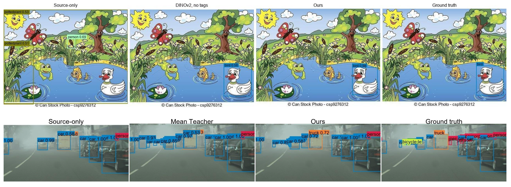

# Weakly Supervised Domain Adaptive Object Detection



An object detector trained on labelled real photographs is adapted to a new visual domain (clipart, fog) **without any bounding boxes in that domain**. Only cheap image-level tags (which classes appear in an image) are used on the target side.

The pipeline has three stages:

1. **Labeller.** A Faster R-CNN head on a frozen **DINOv2 ViT-B/14** backbone is trained on source boxes and labels every target training image once (pseudo-labels).
2. **Tag refinement.** Image-level tags clean up the pseudo-labels using *filter* and *recover*.
3. **Student.** A standard **ResNet-50 FPN Faster R-CNN** is trained on source boxes plus the refined pseudo-labels. Only the student runs at test time (about 0.5 s per image on a laptop CPU).

```
source boxes -> DINOv2 labeller -> pseudo-labels -> tag filter + recover -> ResNet-50 student
```

Built with plain PyTorch, torchvision and timm (no Detectron2).

## Datasets

| Setting | Source (labelled) | Target |
|---|---|---|
| Weakly supervised | PASCAL VOC 07+12 | Clipart1k (image tags only) |
| Unsupervised | Cityscapes | Foggy Cityscapes (no labels) |

## Filter and Recover

- **Filter** removes pseudo-boxes whose class is not among the image's tags. This removes false positives.
- **Recover** keeps the highest-scoring box for any tagged class that has no confident box. This brings back objects the score threshold would have discarded.

On Clipart1k, recover gives most of the gain. Pseudo-label precision / recall rises from 84.1 / 58.9 (threshold only) to 86.2 / 66.4 (filter + recover).

| Pseudo-labels | Student mAP@0.5 |
|---|---|
| Threshold only | 53.9 |
| + Filter | 53.5 |
| + Recover | 57.5 |
| **+ Filter + Recover** | **57.6** |

For comparison, source-only training gets 35.8 and Mean Teacher gets 50.8. On Cityscapes → Foggy Cityscapes, where no tags are available, the DINOv2 pseudo-labels alone take the student from 40.3 (source-only) to 50.5 mAP@0.5.

## Usage

**Setup**

```bash
pip install torch torchvision --index-url https://download.pytorch.org/whl/cu121   # pick the build for your CUDA version
pip install -r requirements.txt
bash scripts/smoke_test.sh            # runs the whole pipeline on synthetic data
```

Place the datasets under `data/`: `VOCdevkit/VOC2007`, `VOCdevkit/VOC2012`, `clipart`, `cityscapes` and `foggy`.

**Training (full pipeline)**

```bash
bash scripts/run_clipart.sh           # VOC -> Clipart1k
bash scripts/run_foggy.sh             # Cityscapes -> Foggy Cityscapes
```

On Windows, use `scripts/run_clipart_priority.ps1` and `scripts/run_foggy_priority.ps1` with `-Stage data | labeller | night | b0 | ...`.

**Evaluation and demo**

```bash
python evaluate.py --ckpt runs/clipart/ours/last.pth --data data/json/clipart_test.json
python demo.py --ckpt runs/clipart/ours/last.pth --input samples --out outputs --device cpu
python demo.py --ckpt runs/clipart/b0/last.pth runs/clipart/ours/last.pth \
    --names "Source-only" "Ours" --input samples --out compare
```
